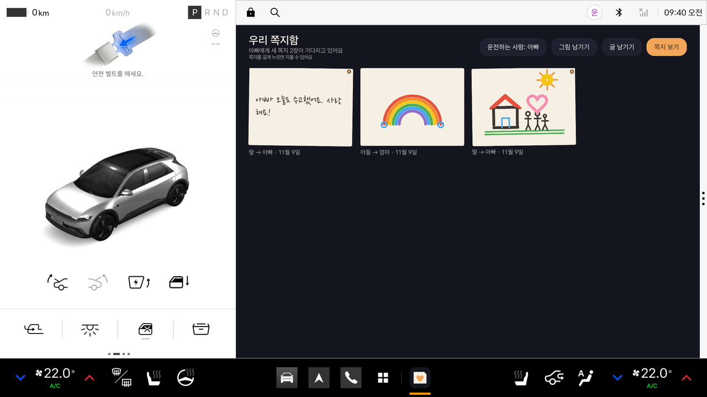
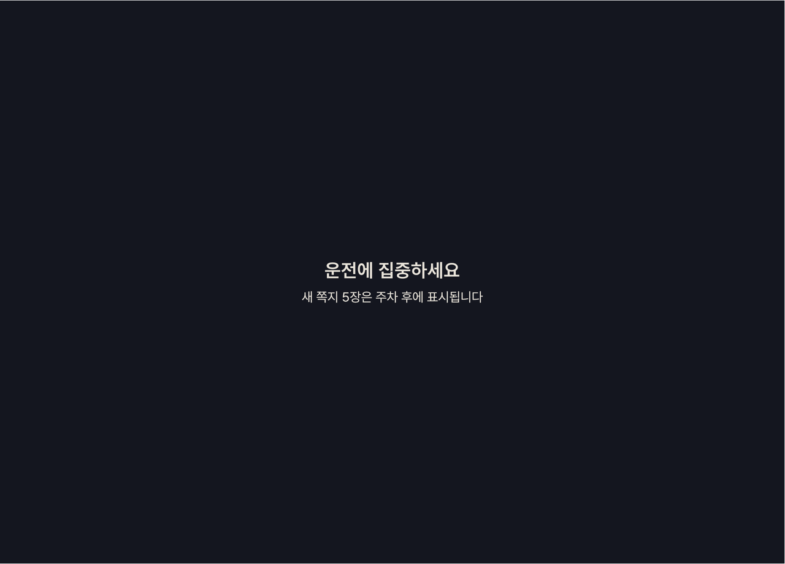
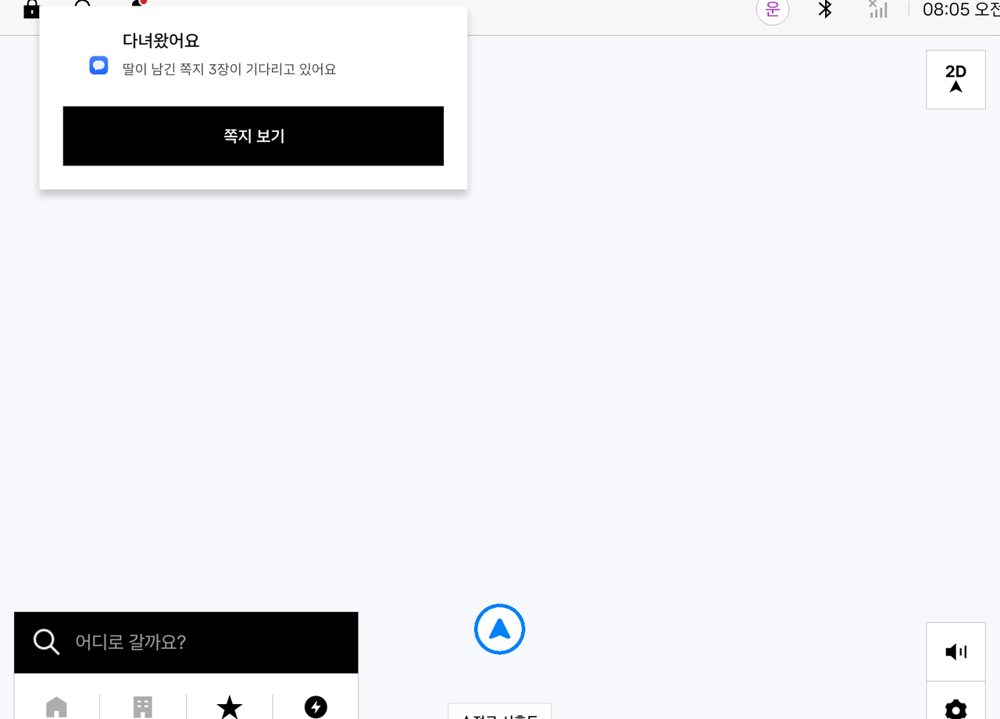
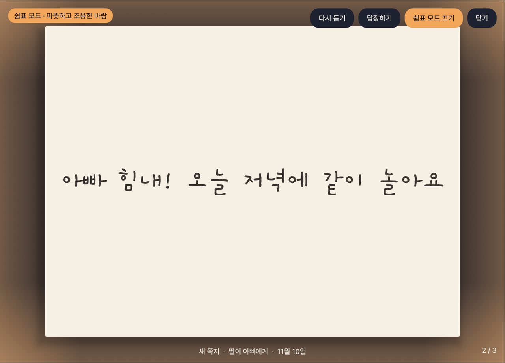
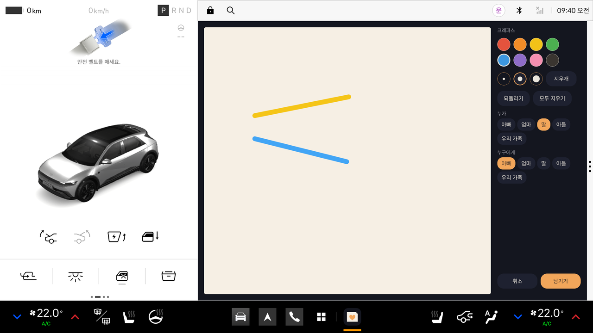

# 온기

**온기(溫氣) — 차가 가족의 우체통이 됩니다.** 가족이 차 화면에 남긴 그림과 쪽지가, 퇴근길에 주차하는 순간 실내 조명과 함께 천천히 펼쳐지는 Pleos Connect 차량용 앱입니다.

## 화면
| 쪽지함 | 운전 중 | 도착하면 열리는 갤러리 |
|---|---|---|
|  |  |  |

| 내비 위로 뜨는 도착 알림 | 멈춤 · 쉼표 모드 | 그림 남기기 |
|---|---|---|
|  |  |  |

*Pleos Connect Emulator v2.1.0에서 캡처. 화면 가장자리 빛과 실내 앰비언트 조명이 그림 색을 따라 바뀐다(Virtual Console로 확인).*

## 주요 기능
| 기능 | 설명 | 사용 SDK |
|---|---|---|
| 그림·글 쪽지 | 정차 중 차 화면에 크레파스로 그림을 그리거나 글을 남김. 보내는 사람과 받는 사람 선택 | — |
| 도착 감지 | 다른 앱(내비 등)이 앞에 있어도 백그라운드 서비스가 기어를 지켜보다가, 주행 후 P단이면 "다녀왔어요" 알림 → 누르면 쪽지가 열림 | Vehicle `Gear` |
| 천천히 펼쳐지는 쪽지 | 운전자에게 온 새 쪽지가 한 장씩 페이드인되고 6초마다 다음 장으로 넘어감 | — |
| 오늘의 운전 한 줄 | 도착 시 "오늘 32km, 48분 운전했어요" | Vehicle `Odometer` |
| 운전하는 사람 설정 | 주 운전자(또는 "우리 가족")에게 온 쪽지만 도착 때 펼침 | — |
| 그림 색을 따라가는 실내 조명 | 그림의 대표색을 뽑아 앰비언트 라이트를 서서히 그 색으로 바꿈. 갤러리를 닫거나 출발하면 원래 조명으로 돌려놓음 | Vehicle `Light` |
| 쉼표 모드 | 공조를 조금 따뜻하고 조용하게 바꾸고, 끝나면 원래 설정으로 복원 | Vehicle `HVAC` |
| 읽어 주기 / 출발 안내 | 갤러리에서 쪽지를 탭하면 소리 내어 읽어 줌. 출발할 때 안 읽은 쪽지가 있으면 음성으로만 알려 줌 | TextToSpeech |
| 말로 답장 | 받은 쪽지에 음성으로 답장 | SpeechToText |

## 운전 중 안전 설계
- P단이 아니면(기어 정보를 아직 모를 때 포함) "운전에 집중하세요"라는 정적인 화면만 보여 준다. 누를 수 있는 요소가 없다.
- 주행을 시작하면 작성 중인 화면을 즉시 닫고, 쉼표 모드와 실내 조명을 원래대로 되돌린다.
- 주행 중 안내는 음성으로만 한다.

## 실행 방법
### 필요한 환경
- Android Studio(또는 Android SDK 명령줄 도구), JDK 17
- Android SDK Platform 34, Build-Tools 34
- Pleos Connect Emulator v2.1.0(API 34). 설치 방법은 [Pleos 개발 문서](https://document.pleos.ai/docs/connect/guide/getting-started/application-development/setup-connect-sdk-emulator)를 따른다.
  - AVD 설정: Automotive / Pleos Connect v2.1.0, **Cold boot**, RAM 4GB

### 빌드
```bash
./gradlew :app:assembleDebug        # app/build/outputs/apk/debug/app-debug.apk
./gradlew :app:assembleRelease      # 서명된 release (keystore.properties 필요, 저장소에 없음)
./gradlew :app:testDebugUnitTest    # 단위 테스트
```
Pleos SDK는 `settings.gradle.kts`에 등록된 Pleos Maven 저장소(`nexus-playground.pleos.ai`)에서 받는다.

### 설치와 실행
```bash
adb install -r apk/김병규_온기_release.apk
adb shell am start -n app.familynote/.MainActivity
```

### 테스트 환경과 필요한 설정
- 확인 환경: Pleos Connect Emulator v2.1.0(API 34) — Apple Silicon(arm64-v8a) 이미지
- 기어 상태(P/D)와 실내 조명·공조는 Pleos Connect Virtual Console(`adb forward tcp:8088 tcp:8088` → http://127.0.0.1:8088)에서 바꾸며 확인한다.
- 처음 실행하면 알림 권한을 묻는다(도착 알림에 필요).
- 처음 "말로 쓰기"를 누르면 마이크 권한을 묻는다. 에뮬레이터에서는 Extended Controls > Microphone에서 호스트 오디오 입력을 켠다.
- Pleos 차량 서비스가 없는 일반 에뮬레이터에서는 debug 빌드만 주차 상태로 시작한다(UI 확인용). release 빌드는 기어 정보가 없으면 잠긴 화면을 유지한다.

## APK
- 위치: `apk/` 폴더의 `김병규_온기_release.apk` (서명된 release 빌드)

## 구조
```
app/src/main/java/app/familynote/
├── vehicle/   VehicleGateway: Pleos Vehicle SDK 래퍼(비동기 콜백 → 타임아웃 있는 suspend 함수), 테스트용 Fake
├── voice/     Pleos TTS/STT 래퍼(플랫폼 TTS 대체 경로 포함)
├── data/      Room DB(쪽지 목록) + 그림 PNG
├── ui/        Compose 화면(쪽지함, 그리기, 글쓰기, 갤러리, 운전 중 화면)과 MainViewModel
└── util/      그림 대표색 추출과 색 전환(ColorMath), 한국어 조사 처리
```

## 라이선스
- 손글씨 글꼴: Nanum Pen Script (SIL Open Font License 1.1, `THIRD_PARTY_FONT_LICENSE.txt`)
